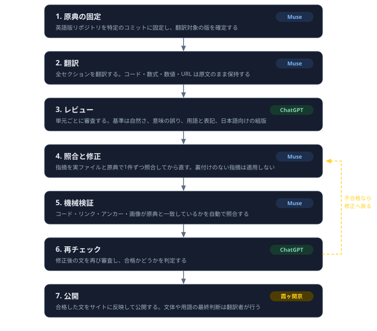

# Hugging Face 学習コース日本語版

Hugging Face が公開している**無料の学習コース（英語）の日本語訳**です。LLM（大規模言語モデル）、AI エージェント、コンピュータビジョンなど、5つのコース・全316セクションを日本語で読めます。

このリポジトリは翻訳文（MDX）の置き場所です。**読む場合はウェブサイト版がおすすめです**（クイズがその場で答え合わせでき、用語集と全文検索が使えます）。

- **ウェブサイト: https://yanikasumin.github.io/HuggingFace-courses-ja/**
- このサイトは Hugging Face 公式コースの**非公式の日本語訳**です。原典（英語）は各コースの公式ページで読めます。

## 収録コース

### 1. [LLM コース](https://yanikasumin.github.io/HuggingFace-courses-ja/llm/)（全104セクション）

大規模言語モデル（LLM）の仕組みを基礎から学ぶ中心コース。Transformer の動作原理、Hugging Face Transformers の使い方、ファインチューニング、データセットとトークナイザの扱い、音声処理や独自モデルの構築までを扱います。

- 公式（英語）: https://huggingface.co/learn/llm-course
- 翻訳文: [`llm-ja/`](llm-ja/)

### 2. [Robotics コース](https://yanikasumin.github.io/HuggingFace-courses-ja/robotics/)（全11セクション）

ロボット学習の入門コース。古典的なロボティクスの基礎（運動学・制御）から、オープンソースライブラリ LeRobot を使ったロボット学習とデータセットの扱いまでを学びます。

- 公式（英語）: https://huggingface.co/learn/robotics-course
- 翻訳文: [`robotics-ja/`](robotics-ja/)

### 3. [Agents コース](https://yanikasumin.github.io/HuggingFace-courses-ja/agents/)（全74セクション）

AI エージェントの仕組みと作り方を学ぶコース。LLM とツールの連携、思考・行動・観察のサイクルを理解し、smolagents や LangGraph を使って実際にエージェントを構築し、評価する方法までを扱います。

- 公式（英語）: https://huggingface.co/learn/agents-course
- 翻訳文: [`agents-ja/`](agents-ja/)

### 4. [MCP コース](https://yanikasumin.github.io/HuggingFace-courses-ja/mcp/)（全36セクション）

Model Context Protocol（MCP）の入門コース。MCP の概念・アーキテクチャ・通信の仕組みを学び、Gradio などと連携する MCP アプリケーションを実際に構築します。

- 公式（英語）: https://huggingface.co/learn/mcp-course
- 翻訳文: [`mcp-ja/`](mcp-ja/)

### 5. [Community CV コース](https://yanikasumin.github.io/HuggingFace-courses-ja/cv/)（全91セクション）

コンピュータビジョンを基礎から学ぶコース。画像処理と CNN の基礎から、物体検出・セグメンテーション・Vision Transformer、拡散モデルやマルチモーダルモデルまでを扱います。

- 公式（英語）: https://huggingface.co/learn/computer-vision-course
- 翻訳文: [`cv-ja/`](cv-ja/)

## どのコースから始めるか

- 機械学習や LLM を基礎から学びたい → **LLM コース**（第1章から順に）
- AI エージェントを作りたい → **Agents コース**（LLM コース第1〜2章程度の知識があると進めやすい）
- 画像認識や画像生成に興味がある → **Community CV コース**（Unit 1 の基礎から）
- LLM に外部ツールをつなぐ仕組みを知りたい → **MCP コース**（短めで、他のコースと並行できる）
- ロボットを学習させたい → **Robotics コース**（全11セクションの入門編）

## 翻訳について

翻訳は、翻訳エージェント（Muse）、審査役（ChatGPT）、翻訳者（霞ヶ関京）の3者で工程を分担し、単元ごとに「翻訳 → レビュー → 照合と修正 → 再チェック」を繰り返して行いました。機械翻訳の出力をそのまま載せるのではなく、指摘と照合の往復で一文ずつ確定していく方法です。

工程の詳細:

1. **原典の固定（Muse）**: 各コースの英語版リポジトリを特定のコミットに固定し、翻訳対象の版を確定しました。原典が後から更新されても、翻訳の基準がぶれないようにするためです。
2. **翻訳（Muse）**: 全316セクションを翻訳しました。見出しのアンカー、コード、数式、数値、URL、データは原文のまま保持し、本文と画面表示のラベルを訳します。モデルへの入力文のように「データ」として扱うべき英文は訳しません。
3. **レビュー（ChatGPT）**: 翻訳文を単元ごとにまとめ、ChatGPT の思考モードで審査しました。基準は、(1) 日本語の自然さ（『とほほのWWW入門』のような平易な解説文が手本）、(2) 意味の誤り、(3) 用語と表記、(4) 改行や記号の配置など日本語読者向けの組版、の4点です。指摘は、対象ファイルと行番号、現在の文の正確な引用、問題点、修正案の全文をセットで出させました。
4. **照合と修正（Muse）**: レビューの指摘はそのままでは適用しません。1件ずつ実ファイルで引用が実在するかを確認し、原典と突き合わせてから修正しました。引用が実在しない指摘や、原典の内容と合わない修正案は、根拠がないものとして適用せず、審査側に再提示を求めました。
5. **機械検証（Muse）**: 修正のたびに、コード・リンク・アンカー・画像が原典と一致しているかを自動で照合し、翻訳の過程で文書の構造が壊れていないことを確認しました。
6. **再チェック（ChatGPT）**: 修正後の文を再び審査し、指摘が解消したかを判定しました。合格にならない場合は「照合と修正」に戻り、解消するまで繰り返しました。意図的に原文どおり残した箇所は、その理由を添えて再チェックにかけています。
7. **公開（霞ヶ関京）**: 合格した文をサイトに反映して公開しました。文体の方針、用語の採否、原典自体に誤りがある場合の扱い（勝手に直さず原文に忠実に訳す）など、判断が要る点は翻訳者が決めています。

役割分担: Muse = 翻訳と照合・修正・検証の実務 / ChatGPT = 第三者としての審査 / 霞ヶ関京 = 工程全体の方針と最終判断。

- 翻訳の方針は [TRANSLATION_RULES_HF.md](TRANSLATION_RULES_HF.md) にまとめています。
- 文体は、原典の内容と情報量を損なわない範囲で、平易で分かりやすい解説文に整えています。手本は『とほほのWWW入門』のような、初学者に向けた平易な解説の文体です。英語の語順をそのまま移さず、日本語として自然な語順と表現に直しています。
- 専門用語は英語の資料や実務でもそのまま通用する表記に統一し、必要に応じて原語を併記しています。漢字で書くのが標準の語は漢字で書くなど、表記も日本語の慣例にそろえています。
- コード、数式、数値、URL、データは原文のままにしています。画面表示のラベルや実行結果の例は本文と対で翻訳し、モデルへの入力文のような「データ」としての英文は原文のまま残しています。
- 原典自体に誤りがある箇所は、勝手に直さず原文に忠実に訳し、必要に応じてその旨を添えています。
- 翻訳は全ページを原典と照合して確認しています。進捗と検証の記録は [PROGRESS.md](PROGRESS.md) にあります。
- 原典がその後更新されている場合、最新の英語版と内容が異なることがあります。

原典リポジトリと、翻訳の基準にしたコミット:

| コース | 原典 | コミット |
|---|---|---|
| LLM | [huggingface/course](https://github.com/huggingface/course) | `8b893f0e` |
| Robotics | [huggingface/robotics-course](https://github.com/huggingface/robotics-course) | `2a50023` |
| Agents | [huggingface/agents-course](https://github.com/huggingface/agents-course) | `9b3d6b3` |
| MCP | [huggingface/mcp-course](https://github.com/huggingface/mcp-course) | `dbfa79b` |
| Community CV | [huggingface/computer-vision-course](https://github.com/huggingface/computer-vision-course) | `8569c3c` |

## ライセンス

原典と同じ Apache License 2.0 です。本リポジトリの翻訳文は原典の派生物であり、著作権は原典の権利者に帰属します。

## 翻訳・公開者

霞ヶ関京（かすみがせき・きょう）。日本の公共政策と財政を学ぶ学生です。機械学習を独学する中で、Hugging Face の公式コースに日本語版がないことを不便に感じ、全5コースを翻訳して公開しました。YouTube では、歴史を題材にした替え歌の投稿もしています。

- GitHub: [@yanikasumin](https://github.com/yanikasumin)
- YouTube: [@KASUMI_MOF](https://www.youtube.com/@KASUMI_MOF)
